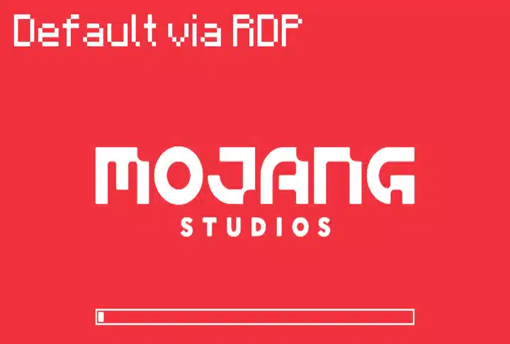
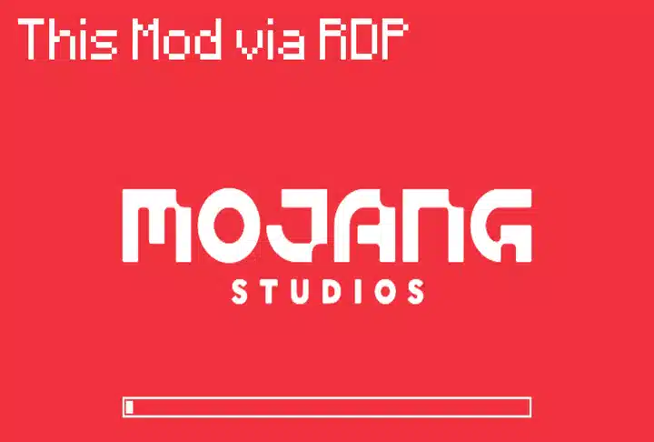

> **Language:** [Русский](README.md) · English

# [MR] True RDP Fix (Fabric 1.21.x)
### MrTrueRdpFix

Fixes mouse look when playing **Minecraft 1.21.x (Fabric)** over **Remote Desktop Protocol (RDP)**.

This mod is inspired by the work of: [**RDPMouse by KesslerCascade**](https://www.curseforge.com/minecraft/mc-mods/rdpmouse)

## Gallery
| Standard Game | With This Mod |
| :---: | :---: |
|  |  |

## The Problem
Minecraft versions 1.13 through 1.21.x bundle LWJGL 3.3.3 with an older GLFW 3.3 build, which fails to handle Windows virtual desktop mouse input over RDP ([MC-126875](https://bugs.mojang.com/browse/MC-126875), GLFW issue [#1276](https://github.com/glfw/glfw/issues/1276)). Under RDP, Windows sets the MOUSE_VIRTUAL_DESKTOP flag, causing the camera to spin uncontrollably into the sky or get stuck at the edge of the monitor.

Mojang resolved this issue only in the 26.X snapshots by upgrading GLFW to 3.4+.

## What Does the Mod Do?
**[MR] True RDP Fix** (MrTrueRdpFix) provides a clean **native backport of GLFW 3.4+** to Minecraft 1.21.x:
1. On startup (before the game window is created), the mod automatically links a native **GLFW 3.4+** library (incorporating official fixes from [PR #1279](https://github.com/glfw/glfw/pull/1279) and [PR #2431](https://github.com/glfw/glfw/pull/2431) with an additional hot RDP connection patch by Mr712) before the game window is initialized.
2. Mouse input is processed natively and hardware-accelerated by GLFW — no input latency, cursor stutter, or fragile Java-level hacks.

## Compatibility
- **Zero Breakage:** Does not affect shaders (Iris), optimization mods (Sodium), textures, or resource packs.
- **Zero Mod Conflicts:** Does not modify Minecraft bytecode (works without Mixins), making conflicts with other mods impossible.
- **Playable Without RDP:** No need to remove the mod from the mods folder when playing locally at your PC — input feels 100% like clean vanilla gameplay.

## Installation
1. Download the latest version from [CurseForge](https://www.curseforge.com/minecraft/mc-mods/mr-true-rdp-fix) or [GitHub Releases](https://github.com/byMr712/MrTrueRdpFix-MinecraftMod/releases).
2. Requirements:
   - Pure Fabric Loader only - other mods like Fabric API are not required.
3. Place the .jar file into your mods folder.
4. Launch the game.

## Building
1. Requires Java 21 and Fabric Loader.
2. Build via:
   `cmd
   build.bat
   `
   или через Gradle:
   `ash
   ./gradlew build
   `
3. The built JAR file will be in uild/libs/.

## Authors & Licenses
- **[MR] True RDP Fix (MrTrueRdpFix):** [GitHub Repository](https://github.com/byMr712/MrTrueRdpFix-MinecraftMod), licensed under the [MIT License](LICENSE).  
  Authors: [Mr712](https://github.com/byMr712), [KesslerCascade](https://github.com/KesslerCascade/RDPMouse).
- **Bundled Third-Party Components:**
  - **GLFW:** [zlib/libpng License](https://www.glfw.org/license.html) (Copyright © Camilla Löwy, Marcus Geelnard & GLFW Contributors). Modified by Mr712 for hot RDP connection support.
  - **LWJGL:** [BSD 3-Clause License](https://www.lwjgl.org/license) (Copyright © Lightweight Java Game Library).
  - Full third-party license texts are documented in [NOTICE.md](NOTICE.md).
